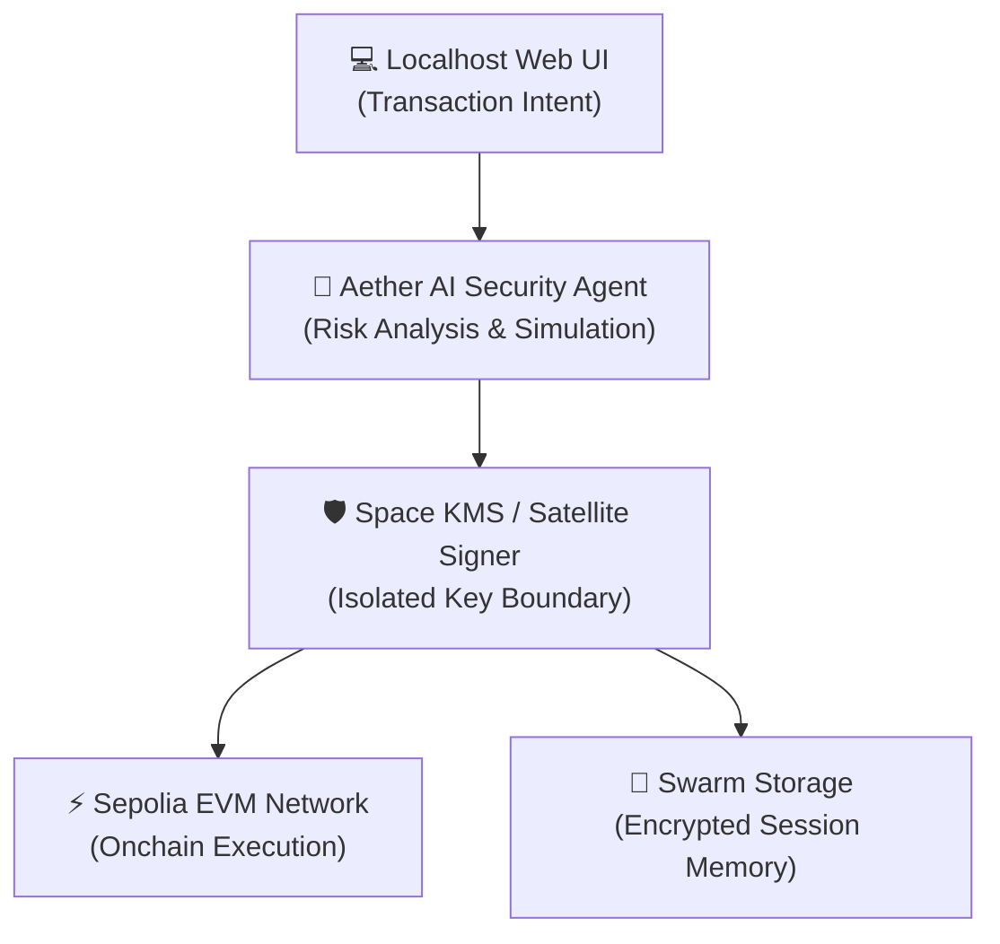

# 🪐 AetherWallet

> **Orbital AI Agent & KMS Vault Wallet with Swarm Decentralized Memory Audit Trails**

[](https://github.com/mohammadali-2000/AetherWallet)
[](LICENSE)
[](https://sepolia.etherscan.io)
[](#tech-stack)

AetherWallet is a local-first, enclave-protected autonomous Web3 wallet system. Transaction intent is generated locally in the browser, analyzed by an AI security agent, signed through a hardware-enclave / satellite KMS signing boundary, and permanently archived as encrypted audit history on Swarm.

---

## 🏛️ System Architecture



---

## 🔐 Core Innovation: 4 Security Trust Layers

1. **Local-First Web UI**: Transaction intents are created exclusively on local environments (`localhost`), bypassing public CDN/DNS attack vectors.
2. **AI Security Agent**: Analyzes calldata, checks address blacklists, verifies slippage, and warns against malicious approvals before execution.
3. **Space KMS Hardware Signing**: Private keys never touch browser memory or cloud backend servers. Signing authority is delegated to an isolated orbital/hardware KMS enclave.
4. **Swarm Encrypted Audit Trails**: Every agent decision and signed transaction is encrypted and permanently archived to Swarm decentralized storage.

---

## 🚀 Quick Start

### Prerequisites
- [Bun](https://bun.sh) (v1.0+) or Node.js (v20+)
- EVM RPC URL (Alchemy / Infura / Sepolia)

### 1. Installation
```bash
git clone https://github.com/mohammadali-2000/AetherWallet.git
cd AetherWallet
bun install
```

### 2. Environment Setup
Create a `.env` file in the root directory:
```env
PORT=3000
RPC_URL=https://eth-sepolia.g.alchemy.com/v2/YOUR_API_KEY
OPENAI_API_KEY=your_openai_key
SWARM_GATEWAY=https://bee-gateways.ethswarm.org
```

### 3. Run the Wallet UI & Agent Server
```bash
# Start the local wallet interface
bun run wallet-ui

# Start the autonomous AI security agent
bun run agents
```
Navigate to `http://localhost:3000` in your browser.

---

## 📖 Handwritten Learning Guide

Want to understand how satellite key isolation, Swarm memory, and AI transaction intent parsing work under the hood?
Read our dedicated guide: [`LEARNING.md`](file:///Volumes/D%20Drive/All%20Code/Blockchian-Proejcts/AetherWallet/LEARNING.md)

---

## 📜 License
MIT License. Built for ETHGlobal & Web3 Hackathons.
